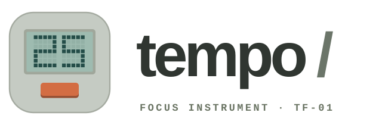
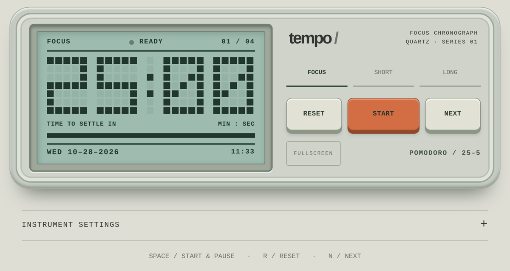

  <picture>
    <source media="(prefers-color-scheme: dark)" srcset="brand/logo-dark.svg">
    
  </picture>

<b>Best with</b> one person · a phone, tablet, or laptop · 25 minutes at a time

<a href="https://datakyle.github.io/tempo/"><b>Open tempo →</b></a>

A retro, LCD-style Pomodoro timer that looks like a little desk instrument. Runs in any browser and installs to your iPhone or iPad Home Screen like a real app.

  
  

## Why this exists

Every timer app wants an account, a streak, and a push notification about your streak. This one wants nothing. It sits there glowing faintly green, counting down like a 1987 calculator that believes in you.

## How to use

1. Open it. Tap **START**.
2. Do one thing until the pixels run out. Yes, one.
3. It chimes, hands you a break, and walks you through 4 rounds before a long break.
4. Open **INSTRUMENT SETTINGS** to change session lengths, LCD colors, the chime, or auto-start.

**On iPhone or iPad:** open the link in Safari, tap Share, then **Add to Home Screen**. It launches full screen with its own icon and keeps the screen awake while a session runs.

**On a keyboard:** `Space` start/pause · `R` reset · `N` next · `F` fullscreen

## Features

- Pixel LCD clock with focus, short break, and long break modes
- Layouts for phone portrait, phone landscape, iPad, and desktop
- Home Screen install with app icon, no browser bars
- Screen stays awake while the timer runs
- Custom session lengths and LCD colors, saved on your device
- Keeps accurate time if you switch apps mid-session
- No accounts, no tracking, no build step

## Run it yourself

It's one HTML file. Open `index.html` in a browser, or host the folder on any static host. The live version runs on GitHub Pages from `main`.

## Notes

- iOS pauses web pages in the background, so the chime plays when you return to the app, not while it's closed.
- Logo and icons live in `brand/` and `icons/`.

---

Made by Kyle Bautista
