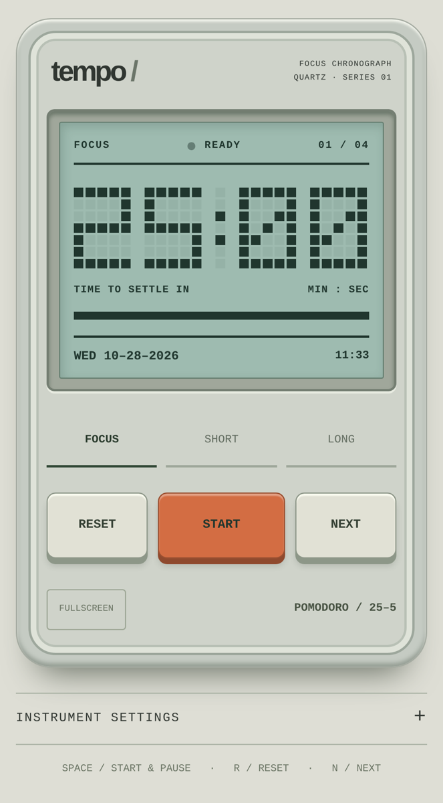
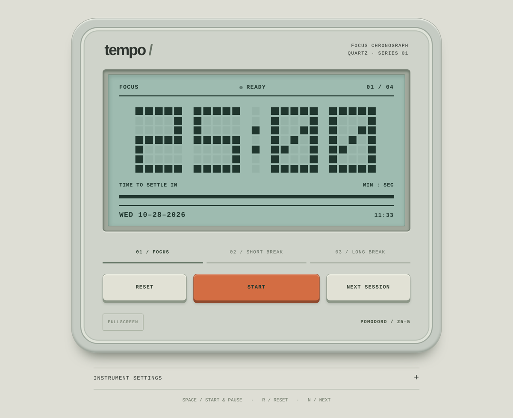

# tempo /

**Best with** one person · a phone, tablet, or laptop · 25 minutes at a time

A retro, LCD-style Pomodoro timer that looks like a little desk instrument. Works in any browser, and installs to your iPhone or iPad Home Screen like a real app.

  
  

## Why this exists

Every timer app wants an account, a streak, and a push notification about your streak. This one wants nothing. It sits there, glowing faintly green, counting down like a 1987 calculator that believes in you.

## How to use

1. Open the page. Tap **START**.
2. Do one thing until the pixels run out.
3. It chimes, switches to a break, and tracks you through 4 rounds before a long break.
4. Tap **INSTRUMENT SETTINGS** to change lengths, LCD colors, the chime, or auto-start.

**On iPhone or iPad:** open it in Safari, tap Share, then **Add to Home Screen**. It launches full screen with its own icon, and keeps the screen awake while a session is running.

**On a keyboard:** `Space` start/pause · `R` reset · `N` next · `F` fullscreen

## Features

- Pixel LCD clock with focus, short break, and long break modes
- Phone portrait, phone landscape (side-by-side layout), and iPad layouts
- Home Screen install with app icon (no browser bars)
- Screen stays awake while the timer runs
- Custom session lengths and LCD colors, saved on your device
- Accurate time even if you switch apps mid-session
- No accounts, no tracking, no build step

## Run it

It is one HTML file. Open `index.html`, or host the folder anywhere static (GitHub Pages works: Settings → Pages → deploy from `main`).

## Notes

- iOS pauses web pages in the background, so the chime plays when you come back to the app, not while it's closed.

---

Made by Kyle Bautista
